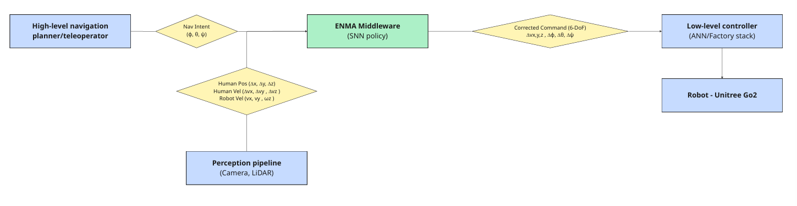
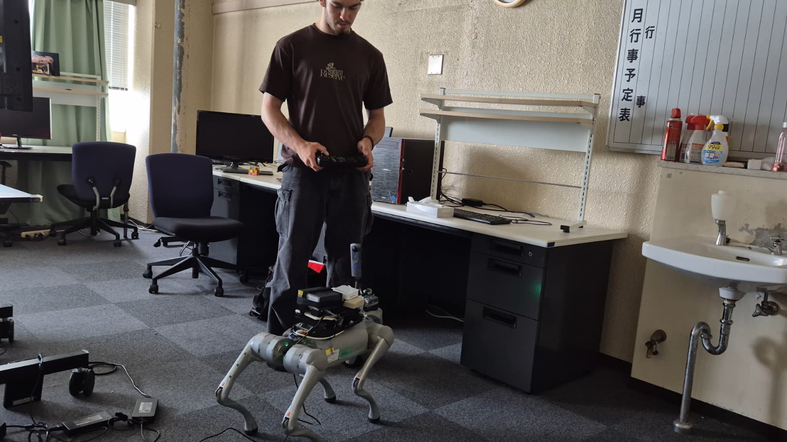
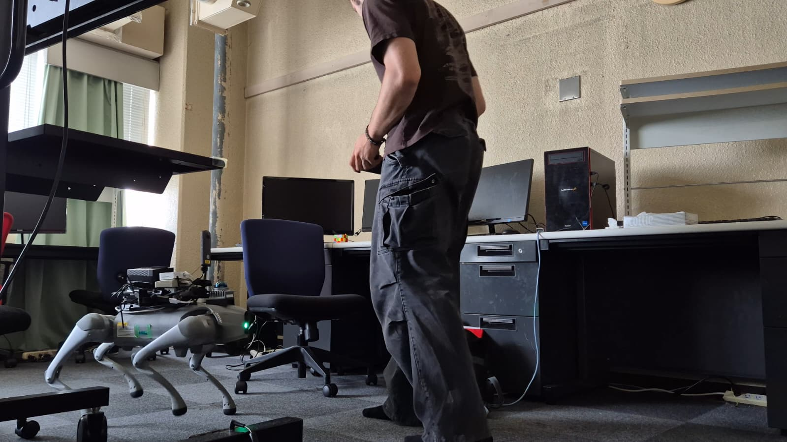
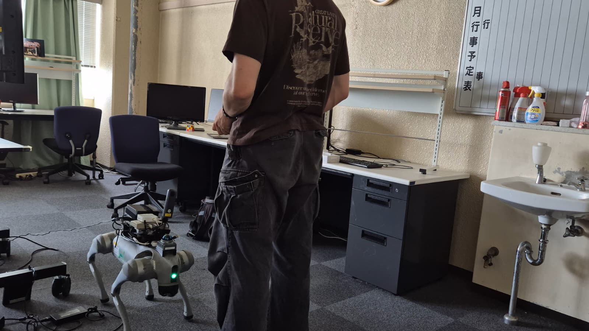

# ENMA: Emotionally-Aware Neuromorphic Motion Adaptation

Code accompanying the paper **"ENMA: Integrating Human Affect into Reinforcement Learning for Legged Locomotion"**
(Marek Hromada, Jun Miura — Active Intelligent Systems Laboratory, Toyohashi University of Technology).

ENMA is a small learned **middleware policy** for a quadruped robot. It sits between a navigation planner (or a
teleoperator) and the robot's existing walking controller, watches the nearest human, and adds a bounded 6-D
correction to the commanded motion. The walking controller itself is never retrained or modified. The reward that
teaches ENMA comes from **Caesar**, a video model that predicts human valence and arousal, so no human raters are
needed during training.



Demo video (real Unitree Go2): <https://www.youtube.com/watch?v=ZvLrn8Owd1M>

| | | |
|---|---|---|
|  |  |  |

## How it works in one minute

```
OFFLINE (teacher -> student)
  video  ->  TRIBE v2 (predicted cortical activity)  ->  SwiFT-style Transformer  ->  valence / arousal pseudo-labels
                                                                                         |
                                                                       trains  Caesar (3D ResNet-18 student)

ONLINE (reinforcement learning in NVIDIA Isaac Lab)
  simulated human's first-person camera  ->  Caesar  ->  valence / arousal  ->  affect bonus
                                                                                    |
  planner command + human state (12-D)  ->  ENMA (spiking actor)  ->  6-D correction  ->  walking controller  ->  Go2
                                               ^                                                    |
                                               +---------------------  PPO update  <----------------+
```

## Repository map

| Folder | What is inside | Start with |
|---|---|---|
| [`ENMAmiddle/`](ENMAmiddle/) | **The core contribution**: spiking policy, PPO training loop, Isaac Lab environment, deployment node | [`model/enma_snn.py`](ENMAmiddle/model/enma_snn.py), [`training/train_enma.py`](ENMAmiddle/training/train_enma.py) |
| [`caesar/`](caesar/) | The student affect model (3D ResNet-18) used as the reward source | [`caesar/README.md`](caesar/README.md) |
| [`teacher_pipeline/`](teacher_pipeline/) | TRIBE v2 + SwiFT teacher that produces the pseudo-labels, and the video data pipeline | [`teacher_pipeline/README.md`](teacher_pipeline/README.md) |
| [`evaluation/`](evaluation/) | Deterministic evaluation script, plotting, and one saved evaluation run | [`evaluation/README.md`](evaluation/README.md) |
| [`checkpoints/`](checkpoints/) | Model files that are available, and a list of the ones that are not | [`checkpoints/README.md`](checkpoints/README.md) |
| [`docs/`](docs/) | Architecture notes, how to reproduce, and diffs of the edited files | [`docs/ARCHITECTURE.md`](docs/ARCHITECTURE.md) |
| [`paper/`](paper/) | Current draft of the paper (PDF) | [`paper/enma-18.pdf`](paper/enma-18.pdf) |

## Suggested reading order (about 5 minutes)

1. [`ENMAmiddle/model/enma_snn.py`](ENMAmiddle/model/enma_snn.py) — the whole policy network in 136 lines: four LIF layers, 16 timesteps, a
   non-spiking readout, bounded outputs.
2. [`ENMAmiddle/training/train_enma.py`](ENMAmiddle/training/train_enma.py) — the PPO loop and the reward: where the camera frames are captured, how
   Caesar scores them, and how the affect bonus is written back into the rollout.
3. [`ENMAmiddle/isaaclab_env/enma_env_cfg.py`](ENMAmiddle/isaaclab_env/enma_env_cfg.py) — the 12-D observation, the human scenarios, and the lines where
   ENMA's correction is added to the planner's command (`final_cmd`).
4. [`caesar/test_fastcnn.py`](caesar/test_fastcnn.py) — the Caesar network in a few lines.
5. [`evaluation/run_evaluation.py`](evaluation/run_evaluation.py) and
   [`evaluation/results_2026-07-09/`](evaluation/results_2026-07-09/) — how configurations are compared with fixed seeds.

## Status of this repository

This is a research code release organised for reading. Please note:

- The scripts were developed on a lab cluster. Their fixed cluster paths have been replaced by command-line
  arguments and environment variables, but the modified scripts have not been re-run yet. They need NVIDIA
  Isaac Lab, the `unitree_rl_lab` package and model checkpoints that are only partly included. See
  [`docs/REPRODUCING.md`](docs/REPRODUCING.md).
- Only some model files are included. The ENMA checkpoints evaluated in the paper and the Caesar weights are **not**
  in this repository yet. See [`checkpoints/README.md`](checkpoints/README.md).
- Most source files are byte-identical copies of the originals. The few that were edited (paths, debug leftovers,
  config consistency) are listed in [`CHANGES.md`](CHANGES.md), with diffs in [`docs/patches/`](docs/patches/).

## Main dependencies

Python 3.10/3.11, PyTorch, torchvision, [snnTorch](https://github.com/jeshraghian/snntorch), NVIDIA Isaac Sim /
[Isaac Lab](https://github.com/isaac-sim/IsaacLab), [`unitree_rl_lab`](https://github.com/unitreerobotics/unitree_rl_lab),
gymnasium, numpy, pandas, OpenCV, tqdm; for the teacher pipeline also the TRIBE v2 model (`facebook/tribev2`),
`yt_dlp` and `filelock`; for deployment ROS 2 with the `unitree_go` messages. See
[`requirements.txt`](requirements.txt); exact versions were not recorded.

## Acknowledgements

ENMA builds on TRIBE / TRIBE v2 (d'Ascoli et al.), SwiFT (Kim et al.), the POPSAN population-coded spiking actor
(Tang et al.), snnTorch, NVIDIA Isaac Lab and Unitree's `unitree_rl_lab`. The physical experiments used a Unitree Go2.

## Citation

```
M. Hromada and J. Miura, "ENMA: Integrating Human Affect into Reinforcement Learning for Legged Locomotion,"
manuscript in preparation, 2026.
```

## License

No license has been chosen yet. Third-party models and frameworks keep their own licenses.
